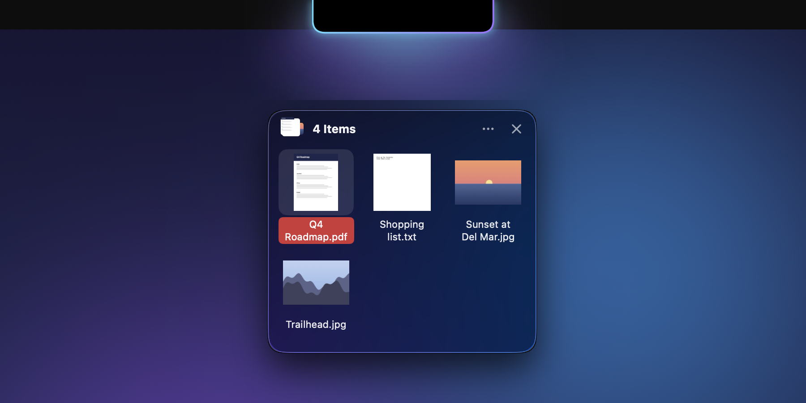
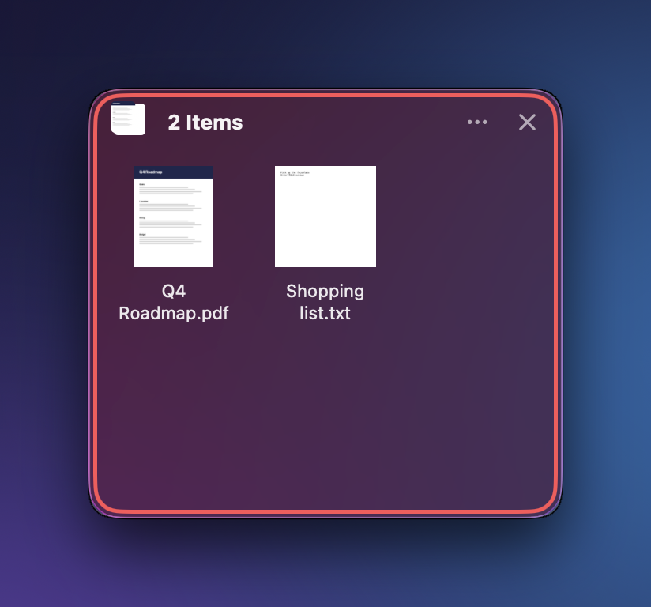
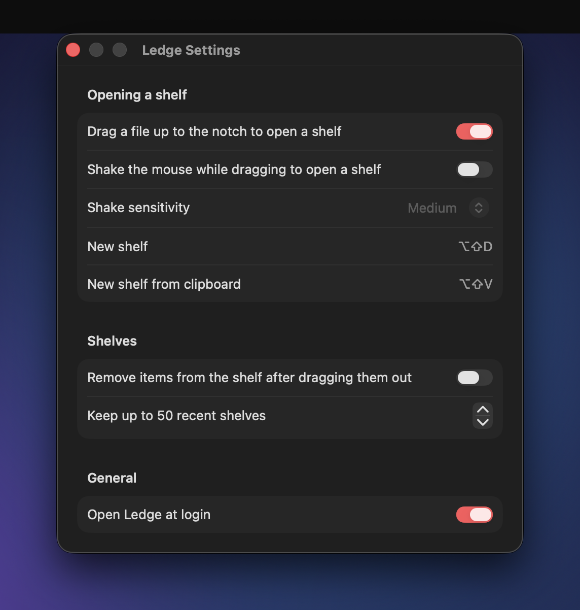

<h1 align="center">Ledge</h1>

<p align="center">A floating file shelf that lives at the top of your Mac's screen.</p>

<p align="center"></p>

Drag a file up to the notch and a shelf drops down to catch it. Park files there while you
move between apps, then drag them out wherever they need to go. Ledge lives in the menu bar,
has no account and doesn't copy your files: it keeps track of them where they already are.

## What it does

- **Drag to the notch.** Pull any file toward the top of the screen and the notch starts to
  glow, brighter as you get close. Let go and a shelf opens right under it.
- **Shortcuts.** <kbd>⌥</kbd><kbd>⇧</kbd><kbd>D</kbd> opens an empty shelf.
  <kbd>⌥</kbd><kbd>⇧</kbd><kbd>V</kbd> opens a shelf holding whatever is on the clipboard: files, text, links or images.
- **Shelves remember.** Close a shelf and it's still in **Recent Shelves** and **All Shelves**
  in the menu bar.
- **Works like Finder.** Click to select, ⌘-click for several, double-click to open.
  Space for Quick Look, Delete to remove, ⌘C and ⌘V to copy and paste, Esc to close.
- **More actions.** Right-click an item, or use the ••• menu, for Open, Quick Look, Show in
  Finder, Copy, Share, Save Copies To and Compress to Zip.
- **Move everything at once.** Drag the icon stack in the top-left corner of a shelf to drop
  all of its files somewhere else.

<p align="center"></p>

The shelf lights up in your accent color while you hold a file over it, so you know the drop will land.

## Settings

Turn on shake-to-open (shake the mouse while dragging), have items leave the shelf once you
drag them out, choose how many shelves history keeps, and decide whether Ledge opens at login.

<p align="center"></p>

On a Mac without a notch, the shelf opens from the top center of the screen instead.

## Install

Ledge needs macOS 26 Tahoe or later on Apple silicon. There's no prebuilt download yet, so build it
from source (it takes under a minute):

```sh
git clone https://github.com/Jamesborlands/ledge.git
cd ledge
./build.sh --install
```

That builds `Ledge.app`, copies it to Applications and opens it. Ledge adds itself to Login
Items on first launch; turn that off in Settings.

The app isn't notarized by Apple. If you copy it to another Mac and macOS says it can't be
opened, right-click it and choose **Open**.

### Where things are stored

Files you drop are referenced in place, not copied. Text, links, images pasted from the
clipboard, and zips you make are saved in `~/Library/Application Support/Ledge`. Clearing
history deletes those, never your original files.

## Building

```sh
./build.sh            # builds build/Ledge.app
./build.sh --install  # also installs it to /Applications and relaunches it
```

The build calls `swiftc` directly because SwiftPM's manifest step fails with some versions of
the Command Line Tools.

| File | What it does |
| --- | --- |
| `Sources/Ledge/AppDelegate.swift` | Starts the app, shortcuts, opening shelves |
| `Sources/Ledge/ShakeDetector.swift` | Watches drags for the notch and for shakes |
| `Sources/Ledge/NotchGlow.swift` | The glow around the notch |
| `Sources/Ledge/ShelfController.swift` | A shelf window and its actions |
| `Sources/Ledge/ShelfView.swift`, `ItemViews.swift` | The shelf itself |
| `Sources/Ledge/ShelfStore.swift` | Saves shelves and history |
| `Sources/Ledge/StatusMenu.swift` | The menu bar menu |
| `scripts/make_icon.swift` | Draws the app icon |

`scripts/snapshots.sh --docs <demo files>` takes the screenshots for this README from the live app, over a plain backdrop so nothing personal is in frame (your terminal needs Screen Recording). Launch Ledge with `open`
(or from Finder) rather than running `build/Ledge.app/Contents/MacOS/Ledge` in a terminal:
macOS otherwise files Ledge's menu bar icon under your terminal app and hides it whenever
that app is switched off in System Settings > Menu Bar.

## License

MIT. See [LICENSE](LICENSE).
